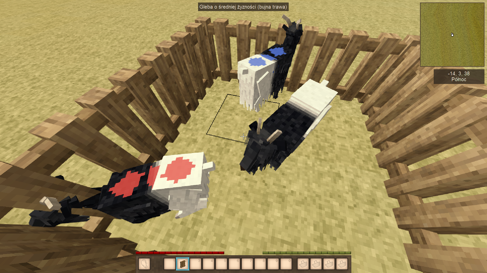

# Livestock Marker

**Vintage Story mod | Version 0.1.0-pre.1 | Author: OnyxBox**

Livestock Marker helps you identify animals in your herd using persistent, player-selected color markings. It is designed for breeding, herd organization, and recognizing individual animals in multiplayer worlds.



## Features in 0.1.0-pre.1

- Assign one of six colors: **red, blue, green, yellow, white, black**.
- Change or remove an animal's marking at any time.
- See the marking color in the animal information tooltip (Polish and English localization).
- Store markings in the world, synchronized through the server in multiplayer. Markings have been tested to persist after server restarts.
- Transfer saved marking data when supported young animals grow into adults.
- Show colored **spots on adult Valais goats**. Other animals may retain marking data and tooltip information without a visible paint spot.
- Reuse generated texture variants through a client-side texture cache.

## Installation

1. Install a compatible Vintage Story version. Development and testing were performed on **Vintage Story 1.22.7**; other versions are not verified.
2. Place the release ZIP **without extracting it** in your Vintage Story data directory's `Mods` folder (on many Linux installs: `~/.config/VintagestoryData/Mods/`).
3. Enable Livestock Marker in Mod Manager and restart the game if required.
4. For multiplayer, install and enable the same release on **server and clients**. The server stores marking changes; the clients render them.
5. Do not load a second development copy of the mod simultaneously.

## Commands

Look directly at an animal before using the command.

| Command | Description |
| --- | --- |
| `/lm info` | Show the targeted animal's entity ID, code and marking color. |
| `/lm mark red` | Set the targeted animal's color to red. |
| `/lm mark blue` | Set the targeted animal's color to blue. |
| `/lm mark green` | Set the targeted animal's color to green. |
| `/lm mark yellow` | Set the targeted animal's color to yellow. |
| `/lm mark white` | Set the targeted animal's color to white. |
| `/lm mark black` | Set the targeted animal's color to black. |
| `/lm clear` | Remove the targeted animal's marking. |
| `/lm` | Show command help. |

Current command permissions allow ordinary players with the standard chat privilege to mark animals. **Ownership and access restrictions are not implemented yet.**

## Current limitations

- Visible texture spots are currently implemented for **adult Valais goats**. Do not expect a painted coat on all species or young animals yet.
- A single active color marking per animal; freely painted designs and text names are planned, not yet implemented.
- No ownership protection, audit history, or animal naming in this release.
- The growth behavior override relies on the original behavior positions of Vintage Story 1.22.7; mod compatibility with other changes to these positions is not guaranteed.

## Build from source

Requires a compatible .NET SDK and the local Vintage Story mod development dependencies configured in the project.

```bash
./build.sh --target=Default --configuration=Release
```

The Cake build prepares an archive under `Releases/`. The build should run from the repository checkout. Run the growth-patch validator before packaging where available:

```bash
python tools/validate_growth_patches.py
```

## Screenshots

All images included with this documentation are actual gameplay screenshots, not AI-generated illustrations.

## Roadmap

See [ROADMAP.md](ROADMAP.md) for text names, player ownership, change history, additional animal textures, and brush painting.

## License

Livestock Marker is licensed under the **MIT License**. See [LICENSE](LICENSE) for the full license text. Third-party Vintage Story assets are not covered by this license.
